<div align="center">
  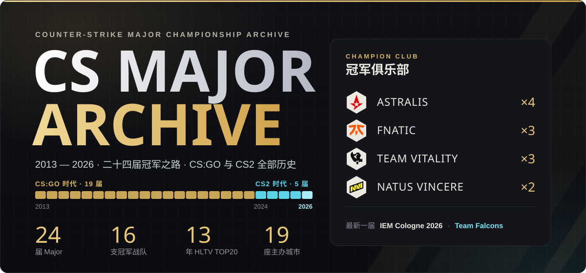
</div>

# CS MAJOR ARCHIVE · 历代 Major 冠军档案

把 CS:GO / CS2 全部 **24 届 Major**(2013 DreamHack Winter — 2026 IEM Cologne)收进一个暗色年鉴式单页:**24 届赛事 · 16 支冠军战队 · 13 年 HLTV TOP20 · 19 座主办城市**——每届的冠军阵容、决赛地图比分、场馆与奖金、HLTV 年度 TOP20,以及由 260 个 TOP20 名额叠出来的常青树榜。

**在线访问:[cs-major-archive.pages.dev](https://cs-major-archive.pages.dev)** · 技术栈:React 19 · TypeScript · Vite · framer-motion · GSAP

<div align="center">
  
</div>

首屏即档案：满幅奖杯照片横幅上，左侧是衬线大标题 COUNTER-STRIKE MAJORS、斜体年份区间与四项核心统计，右侧「FEATURED MAJOR」卡片始终指向最新一届（真实冠军对阵 + 场馆/奖金/日期信息条），点击 VIEW ALL 直达档案详情。

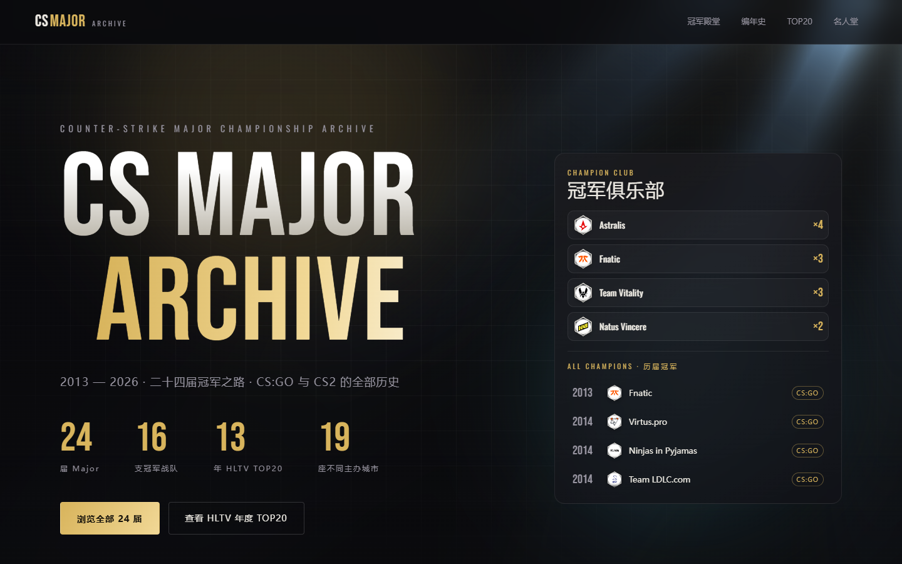

| 冠军殿堂 | 历届征程 · 编年史 |
| --- | --- |
| 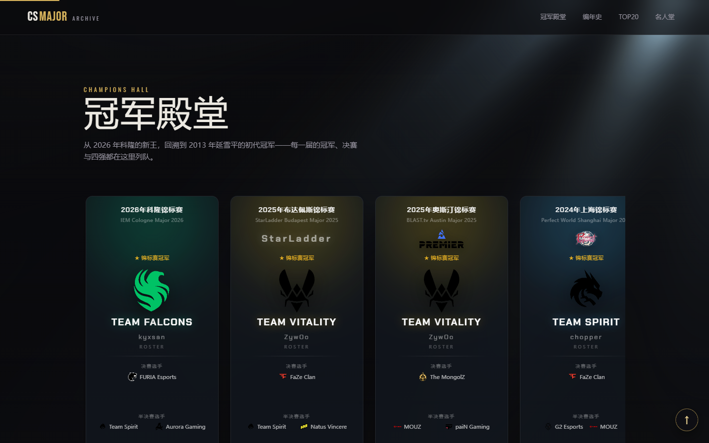 | 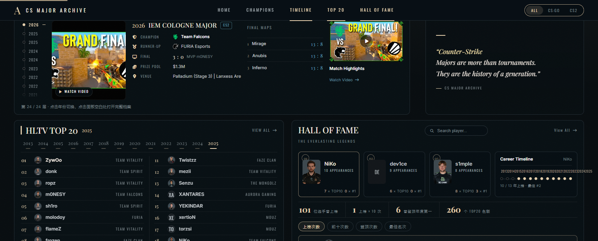 |
| **HLTV 年度最佳选手 TOP20** | **Major 详情页(布达佩斯 2025 为例)** |
| 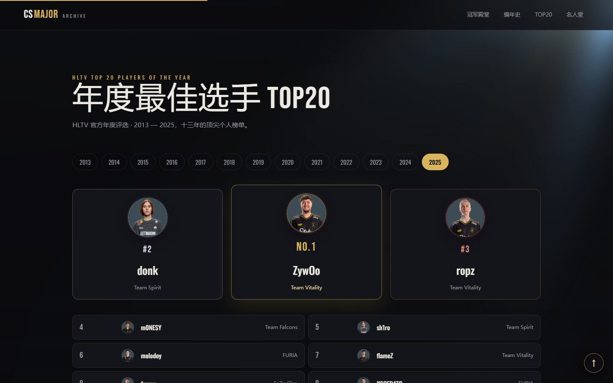 | 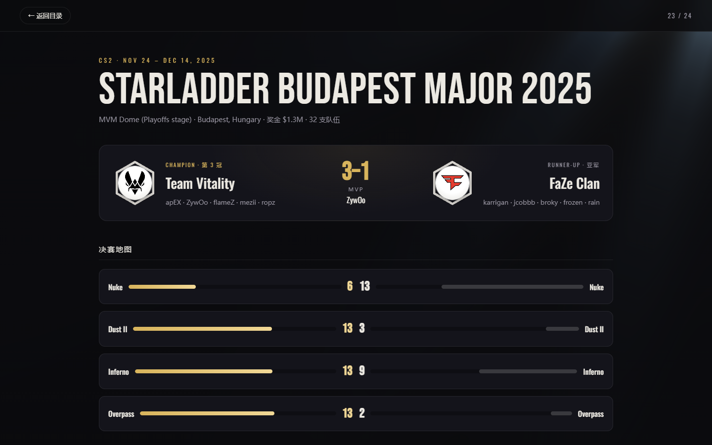 |

移动端保持同一套年鉴语言:长廊横滑、时间轴单列、榜单纵向堆叠。

<p align="center">
  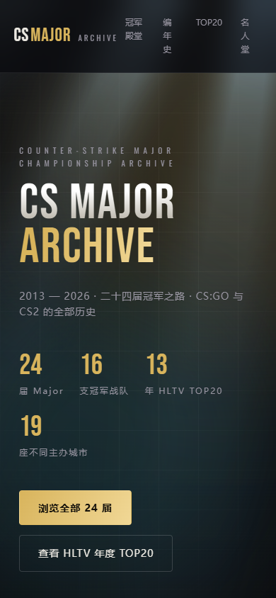
  &nbsp;&nbsp;
  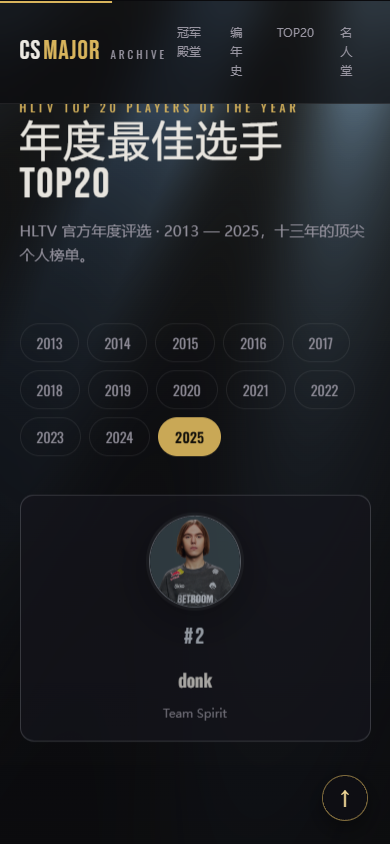
  &nbsp;&nbsp;
  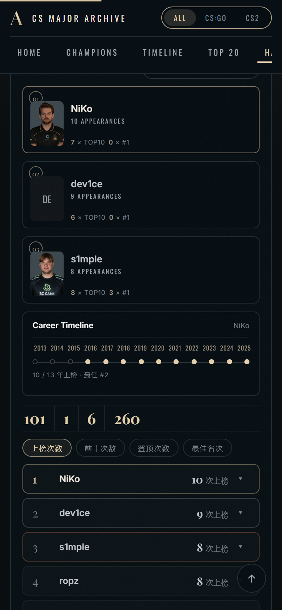
</p>

<div align="center">
  
</div>

- **冠军殿堂** —— 参考图同款窄卡轮播：一卡一届(年份/赛事/队徽/比分/对手)，卡片上半叠暗化赛场照片纹理；左右圆形箭头翻页，支持时代筛选，点击任意一届进入档案详情。
- **编年史(THE CHRONICLE)** —— 年份轨查看器:左侧 24 届年份轨点选切换,右侧以卷宗字段(Champion/Runner-up/Final/Prize Pool/Venue)呈现当届,FINAL MAPS 青色比分、Match Highlights 视频卡与金斜体引言面板并排。
- **HLTV TOP20** —— Editorial 双列年榜:衬线金色名次、真实选手头像、当年所效力战队;年份刻度一键切换,年度第一略作强调。
- **名人堂(HALL OF FAME)** —— 三张传奇卡(真实选手照片 + N APPEARANCES / N × TOP10 / N × #1)+ Career Timeline 年份圆点轴(点击传奇卡切换),下方保留 260 个名额叠加的完整榜单:排序 / 搜索 / 逐年展开。
- **详情页** —— 点击任意一届进入全屏「冠军档案卷宗」:决赛地图比分条、逐图选手数据、淘汰赛梯级、参赛队伍、当年 TOP20 冠军成员、决赛视频(点击播放)。

设计上，全站按参考图《深色〈反恐精英〉Major 历史档案馆界面》做像素级合并：1536px 内容盒、炭黑底 `#060B0E`，暖奶油衬线展示体（Playfair Display，本地打包）与冷灰白 UI 正文双白体系；香槟金 `#E5CFAC` 只用于标签/序号/年份/排名，比分与 rating 为静谧青 `#6CB4C4`；标签体 Oswald、正文 Inter 均本地打包，离线可用。Hero 为 289px 照片横幅（奖杯聚光层 + 人群底图，素材裁自参考图），FEATURED MAJOR 卡右侧嵌 Lanxess Arena 外景条。动效克制——入场渐显、数字滚动、悬停微移、滚动进度，并完整适配 `prefers-reduced-motion`。

<div align="center">
  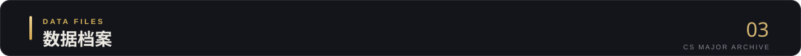
</div>

四份静态 JSON 驱动全站,构建与运行时不请求外部接口:

| 文件 | 内容 |
| --- | --- |
| `data/majors.json` | 24 届赛事元数据:场馆、奖金、冠亚军阵容、四强、八强、全员参赛名单 |
| `data/final_maps.json` | 每届决赛地图与比分 |
| `data/top20.json` | HLTV 年度 TOP20(2013—2025) |
| `data/videos.json` | 每届名场面视频(YouTube,详情页内嵌播放) |

数据整理自 Wikipedia 与 HLTV,视频版权归原作者所有;解析与校验脚本位于 `scripts/`。

<div align="center">
  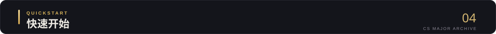
</div>

```bash
npm install
npm run dev        # 本地开发,默认 http://localhost:5173
```

生产构建与预览:

```bash
npm run build
npm run preview
```

推送到 `main` 分支后,GitHub Actions 会自动构建并发布至 Cloudflare Pages(见 [deploy.yml](.github/workflows/deploy.yml))。

## 数据来源与致谢

- 赛事与阵容数据整理自 [Wikipedia](https://en.wikipedia.org/wiki/Counter-Strike_Major_Championships) 与 [HLTV](https://www.hltv.org/),仅作展示用途,版权归原作者所有。
- 战队与主办方徽标来自 Wikimedia / Liquipedia,版权归各俱乐部与赛事方所有。
